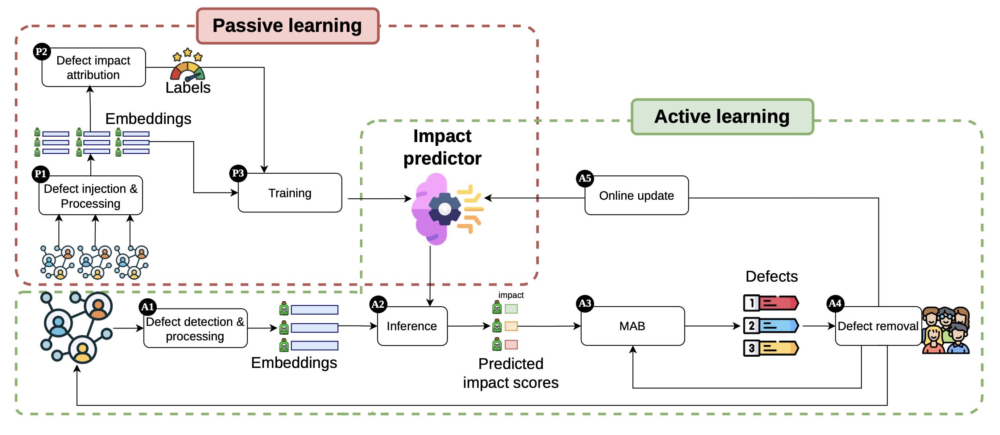

# SCRIBA

This repository contains the code for **SCRIBA: A Budget-Aware Active Learning Framework for Defect Removal in Recommender Systems**, presented as a full paper at the 2027 ACM The Web Conference.

## How SCRIBA works



Recommender systems learn from user interactions, which makes them exposed to noise and manipulation (e.g., fake reviews). Anomaly detectors flag groups of suspicious interactions, called **defects**, but they produce false positives and platforms can only afford to verify a limited number of them. SCRIBA answers the question: *which detector-flagged defects should be removed first to minimise users' exposure to corrupted items under a limited verification budget?*

The pipeline can be paired with any anomaly detector and comprises two main phases: *passive learning* and *active learning*.

### Passive Learning

Performed once, offline, on training graphs that are disjoint from the ones seen at deployment.

**Defect detection and processing**
Anomaly detectors are applied to each training graph to obtain candidate defects (user–item bicliques, item-centred stars, user-centred stars). A GraphSAGE encoder, trained once on all training graphs with a BPR loss, embeds users and items in a shared latent space. Each defect is represented by concatenating the mean-pooled embeddings of its users and of its items.

**Impact attribution**
A LightGCN model is trained once per graph and its input embeddings are stored. The impact of a defect is computed with a leave-one-out (LOO) strategy, without retraining: the stored embeddings are re-propagated on the graph with and without the defect, and the label is the average reduction in the Target NDCG (T-NDCG) of the users affected by it, i.e. the exposure of those users to the defect's target items. Labels are rank-normalised within each graph.

**Predictor training**
The defect representations and their normalised impact labels are used to train a linear regressor (MSE + L2 regularisation) that estimates the impact of a defect without computing the exact LOO. The predictor can then be applied to previously unseen graphs.

### Active Learning

Performed on a new, unseen graph, under a total edge-removal budget `B` and a per-round budget `b`. At each round:

**Detection and representation**
LightGCN is trained on the new graph and the detectors are applied to obtain the candidate set. At every round, candidates are re-encoded with the pretrained GraphSAGE encoder on the current (partially cleaned) graph.

**Impact prediction**
The predictor estimates the impact of each candidate, and the top-ranked ones (up to `m · b` edges) form a pool.

**Bandit-based selection**
A LinUCB contextual bandit selects a batch of defects (up to `b` edges) from the pool, balancing exploitation (high predicted impact) and exploration (uncertain estimates). Selection stops early if no candidate has a positive UCB score.

**Human validation and removal**
The batch is submitted to human moderators, who confirm which defects are actually removed, filtering out false positives.

**Online update**
The exact LOO impact is computed only for the validated defects and used as feedback to update both the bandit and the impact predictor (refitted with ridge regression) before the next round. When the budget is exhausted, LightGCN is retrained from scratch on the cleaned graph.

## Before Getting Started

1. Clone the project.

2. Download the datasets: the Amazon Reviews 2023 subsets ([Amazon Reviews 2023 collection](https://amazon-reviews-2023.github.io/)) and the [Yelp Open Dataset](https://www.yelp.com/dataset).

3. Extract the interaction `.jsonl` files into the following directory:

```text
src/data/original/
```

4. From the root directory of the project, run:

```bash
pip install -r requirements.txt
```

## Preprocessing
Preprocessing prepares the dataset to the subsequent extraction and in general, to the enire pipeline

```bash
python3 preprocessing.py
```


## Extraction
Extraction allows to extract defects from the 6 datasets. The defects will be saved in: data/original/<dataset>/ folder.

```bash
python3 extraction/main_extraction.py
```

## Training
LightGCN model is trained on each dataset (before extraction). 

```bash
python3 src/recbole_f/initial_training.py 
```

## LOO Impact attribution
In this phase we run LOO

```bash
python3 src/recbole_f/loo_defects_tndcg.py 
```

## Embeddings
Generate defects embeddings. 

```bash
python3 src/embeddings_generator/compute_embeddings.py 
```


## Train predictor
Train the impact predictor.

```bash
python3 src/impact_regressor/train.py 
```


## Active learning
Run entire active learning phase: this comprises also mab update, predictor update, embeddings update. The removed defects round by round are all saved inside `mab/results/`.

The example below runs SCRIBA on the Books dataset, with the GSDB detector as backbone, a total budget of 10000 edges and 1500 edges per round.

```bash
python3 src/mab/mab_tndcg.py \
    --defect-type gsdb_ff --online-dataset Books \
    --targets all --policies mab --pools regressor --pool-mult 3 \
    --seeds 0 \
    --regressor src/impact_regressor/scriba_regressor_out/final_model_tndcg.pkl \
    --regressor-active src/impact_regressor/scriba_regressor_out/final_model_active.pkl \
    --regressor-lt src/impact_regressor/scriba_regressor_out/final_model_lt.pkl \
    --emb-dir src/node_embeddings/defects \
    --sage-encoder src/node_embeddings/weights/sage_shared_tndcg.pt \
    --yhat seg --reg-update ridge --reg-train-on chosen+probe \
    --warm-neff 200 --use-exposure --only-touching --hurdle \
    --max-defects 300000 --feature-cache src/mab/features \
    --budget-per-round 500 --max-per-round 50 --total-budget 10000 \
    --probe 20 --holdout 20 --sage-every 5 --probe-update --no-online-scale \
    --reward-transform slog --mab-stop --patience 11800000 --impact tndcg \
    --tag full
```

Main arguments:
- `--defect-type`: anomaly detector used as backbone (`rev2_fff`, `group_ff`, `gsdb_ff`; `group_f` for Beauty_and_Personal_Care).
- `--online-dataset`: the unseen graph on which active learning is run (`Beauty_and_Personal_Care`, `yelp`, `Books`).
- `--total-budget`, `--budget-per-round`: total budget `B` and per-round budget `b` (in edges). `--pool-mult` is `m`, so the pool contains up to `m · b` edges.
- `--max-per-round`: maximum number of defects selected per round.
- `--regressor*`: pretrained impact predictors; `--emb-dir` and `--sage-encoder` contain the defect embeddings and the GraphSAGE encoder.
- `--reg-update`: how the predictor is refitted online (`ridge`, or `none` to keep it frozen).
- `--holdout`: use 100 for all backbones, 20 for `gsdb_ff`.
- `--tag`: name of the run, used to save the results.


## Retraining 
Retrain for final evaluation. In this case, the retraining is performed with all the selected edges removed. 

```bash
python3 src/recbole_f/run_removed_eval_1.py --datasets ${DATASET} \
        --removed-dir /src/recbole_f/removed_defects  \
        --skip-done --skip-existing \
	--out /src/recbole_f/removed_defects
```


## Final evaluation
Get the performances in latex tables and plots.


```bash
python3 src/recbole_f/dump_for_analysis.py dump --no-train \
        --removed-dir src/recbole_f/removed_defects \
        --rre-module run_removed_eval_1 --out src/recbole_f/target_results  
```

```bash
python3 src/recbole_f/eval.py 
```

## Ablation study
Ablation and sensitivity analysis of SCRIBA. Each case is a run of the active learning phase on `Beauty_and_Personal_Care`, `yelp` and `Books`, each with its three detector backbones (`rev2_fff`, `group_ff`, `gsdb_ff`; `group_f` instead of `group_ff` for Beauty_and_Personal_Care). The results are saved inside `mab/results/`, distinguished by the `--tag`.

Every case uses the command below: `<POLICY>`, `<POOL>`, `<YHAT>` and `<REG_UPDATE>` are taken from the grid, and the extra flags of the grid are appended at the end (the last occurrence of a flag overrides the default).

```bash
python3 src/mab/mab_tndcg.py \
    --defect-type gsdb_ff --online-dataset Books \
    --targets all --policies <POLICY> --pools <POOL> --pool-mult 5 \
    --seeds 0 \
    --regressor src/impact_regressor/scriba_regressor_out/final_model_tndcg.pkl \
    --regressor-active src/impact_regressor/scriba_regressor_out/final_model_active.pkl \
    --regressor-lt src/impact_regressor/scriba_regressor_out/final_model_lt.pkl \
    --emb-dir src/node_embeddings/defects \
    --sage-encoder src/node_embeddings/weights/sage_shared_tndcg.pt \
    --yhat <YHAT> --reg-update <REG_UPDATE> --reg-train-on chosen+probe \
    --warm-neff 200 --use-exposure --only-touching --hurdle \
    --max-defects 300000 --feature-cache src/mab/features \
    --budget-per-round 1500 --max-per-round 50 --total-budget 10000 \
    --probe 20 --holdout 20 --sage-every 5 --probe-update --no-online-scale \
    --reward-transform slog --mab-stop --patience 11800000 --impact tndcg \
    --tag <TAG> <EXTRA_FLAGS>
```

For `gsdb_ff` use `--holdout 20`, for the other backbones `--holdout 100`.

**Ablation**

| Tag | Description | `<POLICY>` | `<POOL>` | `<YHAT>` | `<REG_UPDATE>` | Extra flags |
|---|---|---|---|---|---|---|
| `nomab` | Predictor only, no bandit | `regressor` | `regressor` | `seg` | `ridge` | |
| `noreg` | Bandit without predictor | `mab` | `none` | `none` | `ridge` | |
| `frozen` | Predictor not updated online | `mab` | `regressor` | `seg` | `none` | |
| `single` | Whole budget in one round | `mab` | `regressor` | `seg` | `ridge` | `--budget-per-round 50000 --max-per-round 0 --rounds 1` |
| `random` | Random selection | `random` | `random` | `seg` | `ridge` | |

**Sensitivity** (`<POLICY>=mab`, `<POOL>=regressor`, `<YHAT>=seg`, `<REG_UPDATE>=ridge`)

| Tag | Parameter | Extra flags |
|---|---|---|
| `alpha0` | Exploration coefficient 0 | `--alpha 0` |
| `alpha03` | Exploration coefficient 0.3 | `--alpha 0.3` |
| `alpha15` | Exploration coefficient 1.5 | `--alpha 1.5` |
| `pool3` | Pool multiplier `m` = 3 | `--pool-mult 3` |
| `pool10` | Pool multiplier `m` = 10 | `--pool-mult 10` |
| `pool20` | Pool multiplier `m` = 20 | `--pool-mult 20` |
| `b10` | Max 10 defects per round | ` --max-per-round 10` |
| `b100` | Max 100 defects per round | ` --max-per-round 100` |
| `B200` | Max 200 defects per round | ` --max-per-round 200` |
| `B500` | Max 500 defects per round | ` --max-per-round 500` |
